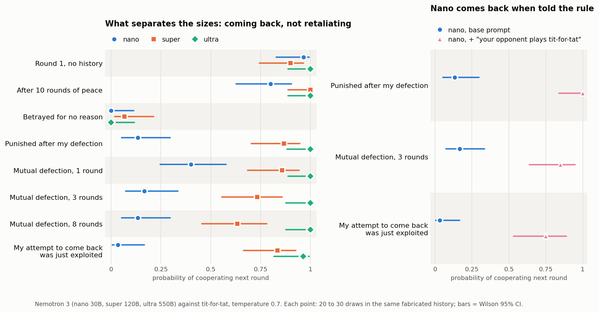

# What separates three sizes of the same model is knowing how to come back

> **En bref (français).** Un agent LLM joue le dilemme du prisonnier itéré contre
> Donnant-donnant, à trois tailles d'un même modèle (Nemotron 3 : 30B, 120B, 550B).
> Les trois rendent les coups quand on les trahit ; ce qui les sépare, c'est de
> **revenir à la coopération après avoir été puni** : 0,13 pour le plus petit,
> 0,87 et 1,00 pour les deux autres, dans le même historique fabriqué. Le plus
> petit lit parfaitement la partie, mais ne prévoit pas qu'un imitateur pardonne ;
> quand on lui dit que l'adversaire joue Donnant-donnant, il revient (0,13 → 1,00).
> L'écart survit à quatre variantes de l'invite. Le carnet de recherche complet
> est dans `RECHERCHE.md`.

An LLM agent plays the iterated prisoner's dilemma against tit-for-tat, at three
sizes of the same model (Nemotron 3: nano 30B, super 120B, ultra 550B). The
starting question was: *is the bigger model nicer?*

No, and the question was badly posed. **All three sizes retaliate**: betrayed for
no reason, they all hit back. What separates them is what happens **after**:
coming back to cooperation once they have been punished.



**The smallest one reads the game perfectly, but does not expect an imitator to
forgive — and when told, it comes back.**

## The result, in three measures

**1. In the same fabricated history, repair separates the sizes.**
Each model is placed in exactly the same situation and asked 30 times.
Probability of cooperating on the next round, original prompt:

| situation | nano | super | ultra |
| --- | --- | --- | --- |
| betrayed for no reason (retaliate?) | 0.00 | 0.07 | 0.00 |
| **punished after its own defection** (come back?) | **0.13** | **0.87** | **1.00** |
| mutual defection for 3 rounds | 0.17 | 0.73 | 1.00 |
| its attempt to come back was just exploited | 0.03 | 0.83 | 0.96 |

**2. It holds in full games** (50 rounds, tit-for-tat):

| tier | games | never defects | games with a defection that end repaired | mean payoff/round |
| --- | --- | --- | --- | --- |
| nano | 18 | 0 | **0 / 18** | 1.58 |
| super | 16 | 2 | **13 / 14** ¹ | 2.94 |
| ultra | 20 | 19 | 1 / 1 | 3.00 |

¹ The 14th defects on round 49 and is punished on round 50: the game ends before
it can come back. The horizon cuts it off, not a refusal.

**3. The mechanism.** Two comprehension questions, asked separately:

| | nano | super | ultra |
| --- | --- | --- | --- |
| "what did the opponent play last round?" | **1.00** | 1.00 | 1.00 |
| "what will it play now?" when the right answer is *it returns my cooperation* (after my attempt was exploited) | **0.40** | 1.00 | 0.87 |

Then the intervention: we add *"Your opponent plays tit-for-tat"* to the prompt.
Punished nano goes from **0.13 to 1.00**, trapped from 0.17 to 0.85, after an
exploited attempt from 0.03 to 0.75.

Nano does not lack information; it lacks a **model of the opponent**. One nuance
that is not smoothed over: even when it predicts correctly (0.73 of cases, when
punished), it only comes back 0.13 of the time. Predicting is not enough to make
it act; the stated rule is.

## What was done to try to break it

- **Removing selection.** In a game, a model that never defects is never
  punished: ultra was punished **once in 1,000 rounds**, so its initial "100%"
  was a single move. Hence the state probes, where every size gets the same
  history.
- **Changing the prompt** (§6.5 of the notebook). Four variants: original,
  reworded goal, options in the other order, and **neutral A/B labels** without
  the name of the game. The repair gap survives all four.
- **A caveat that is also a result.** With A/B labels, **nano defects even in
  full peace** (0 out of 20, against 0.80 with the words). Its baseline
  cooperation is carried by the vocabulary. Super and ultra barely move.
- **Reading the reasoning.** When super opens by defecting, it writes that
  defecting is "*the dominant action*" and "*the safe answer*": dominance and
  worst case, not "I'm testing its reaction".
- **Testing the measures themselves** (`test_mesures.py`, 13 tests). One checks
  that the probe prompt is identical, character for character, to the game
  prompt; another establishes that **a one-round repair time is a mechanical
  floor** against tit-for-tat (coming back means taking the 0 once). So time
  could not separate the sizes; the rate could.

## The bug that leaned the flattering way

The very first run reported **96% cooperation** for nano. The real number is
**16%**. At `max_tokens=600`, the reasoning consumed the whole budget, the API
returned `content: null`, and my fallback counted those rounds as "cooperate".

**An unread move is not guessed.** In games, it fails the game; in probes, it is
recorded as unreadable and **never removed** — removing it would be a second
draw, biased if unreadability depends on the move. `resultat_600jetons.json` is
kept on purpose, as evidence.

## What it is not worth

- **One opponent** (tit-for-tat), **one model family** (Nemotron 3), **one
  temperature** (0.7). The claim is about three sizes of one family, not about
  "LLMs".
- **Dropouts.** 64 games dropped in total: 54 on network failures
  (`getaddrinfo failed`, disconnections), which cannot correlate with a game's
  outcome; **10 on two unreadable moves in a row** (6 nano, 4 super). Even if
  the 6 missing nano games had all repaired, nano would be at 6 out of 24
  against 13 out of 14.
- **Probes cut reasoning at 6,000 tokens**: 1 to 3 unreadable answers per cell
  for ultra in the deep states, excluded and counted separately in
  `analyse_sondes.py`.
- **No model ranking, and there won't be one.** The sibling repository showed
  that leaderboards depend on the field.

## What it costs

| | calls | cost |
| --- | --- | --- |
| full games (54) | ~2,700 | $1.96 |
| state probes | 1,838 | $3.90 |

The cost of a round is carried by deliberation, not by the game: the answer is
one word, the reasoning hundreds to thousands of tokens (medians measured in the
probes: nano 636, super 734, ultra 1,471).

## The baselines come from the sibling repository

[`Yoh5/tit-for-tat`](https://github.com/Yoh5/tit-for-tat) is the deterministic
reference tournament: Pavlov recovers from an accident in 2 to 3 rounds, whereas
two tit-for-tats fail to recover in 76 to 79% of cases. The payoff matrix is
**imported** from that repository, never copied.

## Running it

The two sibling repositories are expected next to this one (`AI_RACINE` lets you
put them elsewhere):

```
some-folder/
├── tit-for-tat/        github.com/Yoh5/tit-for-tat   (matrix and strategies)
├── glassbox/           github.com/Yoh5/glassbox      (Nebius client, usage counters)
└── tit-for-tat-llm/    this repository
```

```bash
export NEBIUS_API_KEY=...          # set NEBIUS_API_KEY=... on Windows

python reparation.py --repetitions 20                       # full games
python sondes_etats.py --variantes base --n 30              # state probes
python sondes_etats.py --variantes lettres objectif ordre   # prompt robustness
python sondes_etats.py --variantes q_dernier q_prediction   # comprehension
python sondes_etats.py --variantes indice                   # the intervention
python analyse_sondes.py                                    # all tables
python figure_reparation.py                                 # the figure (matplotlib)
python -m pytest test_mesures.py                            # the tested measures
```

Every game and every draw is written as soon as it finishes (`reparation.jsonl`,
`sondes_etats.jsonl`): an interruption re-spends nothing, and restarting resumes
where it stopped. All figures and tables are recomputed from these two files.

The code identifiers and the analysis output are in French (*palier* = tier,
*puni* = punished, *piège* = trap, *tentative* = attempt, *coup illisible* =
unreadable move).

## The notebook

`RECHERCHE.md` is the research notebook: the starting hypothesis refuted and
declared as such, the variable reframed twice, and the full campaign in §8.
It is the part of this repository I would read first.

## License

Apache-2.0. See `LICENSE`.
